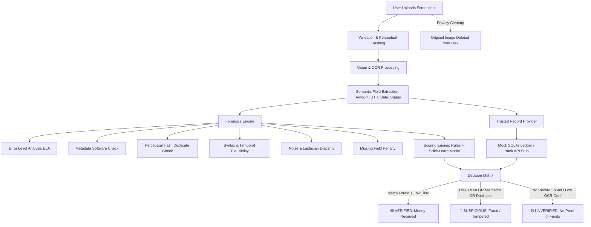

# CleanCheck 🛡️

> **"Don't trust the screenshot. Verify the transaction."**  
> *A prototype built for Parakram Hackathon 26*

CleanCheck is a web application designed to protect local shopkeepers, delivery partners, and online merchants from fake and tampered payment screenshots (UPI, Paytm, PhonePe, Google Pay, and bank transfers).

---

## 🎯 The Core Principle

> **A screenshot alone is NEVER proof of payment.**  
> In today's digital economy, fake payment generator apps and mobile photo editors can forge realistic UPI receipts in under 15 seconds. CleanCheck establishes a zero-trust verification pipeline: **Only a cryptographic or ledger match with trusted transaction records can produce a "VERIFIED" status.**

---

## 🚀 Key Features & Capabilities

- 📱 **Mobile-First & Touch Optimized:** Clean, lightweight single-page interface with high-contrast status cards, large touch targets (48px+), and bilingual indicators (English + Hindi) for quick on-the-counter use.
- 🔍 **Vision & OCR Pipeline:** Extracts claimed amount, 12-digit UPI reference (UTR), timestamps, sender/receiver VPAs, and payment app signatures.
- 🔬 **6 Multi-Layer Forensic Engines:**
  1. **Error Level Analysis (ELA):** Detects localized re-compression variance, digital splicing, and generates a vivid scientific color heatmap.
  2. **Metadata Tampering Check:** Scans EXIF/PNG chunks for software signatures (*Photoshop, Canva, GIMP, Picsart, Snapseed*, etc.).
  3. **Duplicate & Reuse Detection:** Uses perceptual hashing (pHash, Hamming distance) and historical cross-checks to prevent re-used payment screenshots.
  4. **Text Consistency & Syntactic Rules:** Validates 12-digit numeric UPI standards, currency formatting, non-future dates, and plausible timestamps.
  5. **Layout & Noise Inconsistency:** Analyzes Laplacian variance and font sharpness disparities between the amount/UTR bounding boxes and background texture.
  6. **Missing Proof Penalty:** Penalizes screenshots omitting mandatory transaction identifiers.
- 🤖 **Hybrid Decision Engine:** Blends rule-based forensic weights with a secondary **scikit-learn** model trained on synthetic feature distributions.
- 🏦 **Decoupled Trusted Record Provider:**
  - `MockLedgerProvider`: Local SQLite ledger pre-seeded with 30 realistic Indian payment transactions.
  - `RealProviderStub`: Production-ready interface showing where authorized NPCI / Bank APIs or Account Aggregator webhooks plug in.
  - Interactive **Demo Ledger** page where testers can view and add simulated payments in real-time.

---

## 🏗️ Architecture & Verification Flow



---

## ⚡ Quick Start (One Command Run)

### Prerequisites
- Python 3.10, 3.11, or 3.12 installed on your machine.
- Git (optional).

### 1. Clone or Open Project Directory
```powershell
cd "c:\Users\Aditi\OneDrive\Desktop\clean check"
```

### 2. Install Python Dependencies
```powershell
pip install -r requirements.txt
```
*(Dependencies: Flask, Pillow, opencv-python-headless, pytesseract, imagehash, numpy, scikit-learn, pytest, joblib)*

### 3. (Optional) Tesseract OCR Setup on Windows
CleanCheck includes an automatic embedded test reader fallback for offline testing. For full OCR on arbitrary real-world screenshots:
1. Install Tesseract OCR:
   ```powershell
   winget install UB-Mannheim.TesseractOCR
   ```
   *Or download installer from:* [UB-Mannheim Tesseract Releases](https://github.com/UB-Mannheim/tesseract/releases)
2. Default installation path is `C:\Program Files\Tesseract-OCR\tesseract.exe` (CleanCheck automatically discovers this path).

### 4. Run CleanCheck
```powershell
python app.py
```
Open your browser and navigate to: **[http://127.0.0.1:5000](http://127.0.0.1:5000)**

---

## 🧪 Automated Test Suite (21 Tests)

Run the automated pytest test suite covering the parser, decision matrix, duplicate hash detection, and Flask REST API endpoints:
```powershell
pytest -v
```

**Test Coverage Summary:**
- `tests/test_parser.py`: Regex currency extraction, 12-digit UTR detection, date parsing, app detection.
- `tests/test_decision.py`: Verified, Suspicious (amount mismatch), and Unverified decision logic.
- `tests/test_duplicates.py`: Perceptual hash collision, Hamming distance, duplicate re-upload blocking.
- `tests/test_api.py`: `/api/health`, `/api/ledger` (GET & POST), `/api/samples`, and `/api/analyze` end-to-end tests.

---

## ⏱️ 3-Minute Demo Walkthrough

### Scenario 1: The Genuine Customer Payment (Outcome: VERIFIED 🟢)
1. In the **Verify Screenshot** tab, look at the **⚡ Try Pre-Generated Demo Samples** section on the left.
2. Click **"Genuine Google Pay Receipt"**.
3. Watch the animated 5-stage scanning laser.
4. **Result:**
   - Status badge turns **EMERALD GREEN: VERIFIED (PAISE MIL GAYE)**.
   - Risk score meter indicates low risk (~10/100).
   - Extracted details show `₹750.00`, UTR `428901928374`, and status `SUCCESS`.
   - Trusted Record card confirms: *Transaction ID '428901928374' verified against bank ledger*.

### Scenario 2: The Tampered Amount Scam (Outcome: SUSPICIOUS 🔴)
1. Click **"Tampered / Forged Amount Screenshot"**.
2. This screenshot claims **₹7,500.00**, but only ₹750 was received in the bank ledger!
3. **Result:**
   - Status turns **CRIMSON RED: SUSPICIOUS (FAKE / FRAUD - सामान मत दो)**.
   - Risk score jumps to **HIGH RISK (>= 60/100)**.
   - Forensic breakdown flags:
     - *Metadata Check (Risk: 90/100)*: Tampering detected; graphic software signature (`Adobe Photoshop 2024`) found.
     - *Bank Record Discrepancy*: "Amount mismatch: Screenshot displays ₹7,500.00, but trusted ledger record has ₹750.00."
   - ELA Heatmap displays visual compression disparity around the edited amount.

### Scenario 3: The Duplicate Screenshot Re-Upload (Outcome: SUSPICIOUS 🔴)
1. Click **"Duplicate Screenshot Re-upload"**.
2. **Result:**
   - Status turns **CRIMSON RED: SUSPICIOUS**.
   - Perceptual hash (pHash) matches the previous scan: *"Duplicate screenshot detected! Visually identical image was already analyzed."*

### Scenario 4: The Non-Payment Photo / Menu (Outcome: UNVERIFIED 🟡)
1. Click **"Non-Payment Image / Store Banner"**.
2. **Result:**
   - Status displays **AMBER: UNVERIFIED (RECORD NOT FOUND)**.
   - Highlights CleanCheck's core rule: *No trusted bank record found. A screenshot alone is never proof of payment.*

### Scenario 5: Live Simulation via Demo Ledger
1. Click the **Demo Ledger** tab at the top.
2. Under **"Simulate Received Payment"**, insert a custom payment:
   - UTR: `488811112222`
   - Amount: `1500.00`
   - Payer: `Amitabh Verma`
3. Click **+ Add to Trusted Ledger**.
4. The transaction immediately appears in the active bank records table.

---

## 📁 Project Structure

```
clean-check/
├── app.py                     # Flask server and REST API endpoints
├── config.py                  # Forensic weights, risk thresholds, paths
├── requirements.txt           # Python package dependencies
├── PLAN.md                    # Architecture and development roadmap
├── README.md                  # Documentation and demo guide
├── cleancheck.db              # SQLite database (ledger & scan history)
│
├── backend/                   # Core business logic
│   ├── __init__.py
│   ├── db.py                  # SQLite models and seed transactions
│   ├── ocr.py                 # Tesseract OCR and image pre-processing
│   ├── parser.py              # Semantic regex parsing for UPI/bank receipts
│   ├── forensics.py           # 6 forensic checks (ELA, metadata, pHash, etc.)
│   ├── scoring.py             # Hybrid rule + ML scoring and decision engine
│   ├── providers.py           # TrustedRecordProvider, MockLedgerProvider, RealProviderStub
│   └── models/
│       └── risk_classifier.joblib  # Serialized scikit-learn Random Forest model
│
├── static/                    # Frontend assets
│   ├── style.css              # Obsidian glassmorphic design system
│   ├── app.js                 # Vanilla JS state, dropzone, animations
│   ├── uploads/               # Temporary ingestion (deleted post-analysis)
│   └── output/                # Generated ELA heatmaps
│
├── templates/
│   └── index.html             # Single-page responsive HTML application
│
├── samples/                   # Pre-generated realistic test screenshots
│   ├── sample_genuine.png
│   ├── sample_tampered.png
│   ├── sample_duplicate.png
│   └── sample_non_payment.png
│
├── scripts/                   # Tooling scripts
│   ├── generate_samples.py    # Pillow demo screenshot generator
│   └── train_model.py         # Synthetic forensic training script
│
└── tests/                     # Pytest automated test suite
    ├── __init__.py
    ├── test_parser.py
    ├── test_decision.py
    ├── test_duplicates.py
    └── test_api.py
```

---

## ⚖️ Known Limitations & Honest Disclosure

1. **Forensics Provides Probabilistic Signals, Not Mathematical Proof:**  
   Image forensics (including Error Level Analysis and Laplacian noise analysis) computes statistical likelihoods of tampering. Clean uncompressed originals or heavily re-compressed images (e.g., forwarded repeatedly over WhatsApp or Telegram) may exhibit compression artifacts that do not necessarily mean malicious intent.
2. **Authorized Banking Access is Essential for Absolute Verification:**  
   CleanCheck's architecture demonstrates how bank webhooks, Account Aggregators (AA), or NPCI UPI status inquiry APIs connect via `TrustedRecordProvider`. In this prototype, records are simulated in a local SQLite ledger (`MockLedgerProvider`). In production, integration with licensed payment aggregators or core banking systems is mandatory.
3. **Machine Learning Model Scope:**  
   The secondary scikit-learn Random Forest classifier included in `risk_classifier.joblib` was trained on synthetic statistical feature distributions (`scripts/train_model.py`) to demonstrate hybrid rule-ML scoring. In commercial deployments, this model would be trained on proprietary, anonymized historical fraud and chargeback datasets.
4. **Privacy-by-Design:**  
   Uploaded screenshots are analyzed in memory/temporary storage and immediately unlinked/deleted from disk once processing concludes. Only non-reversible perceptual hashes and generated ELA heatmaps are persisted.
